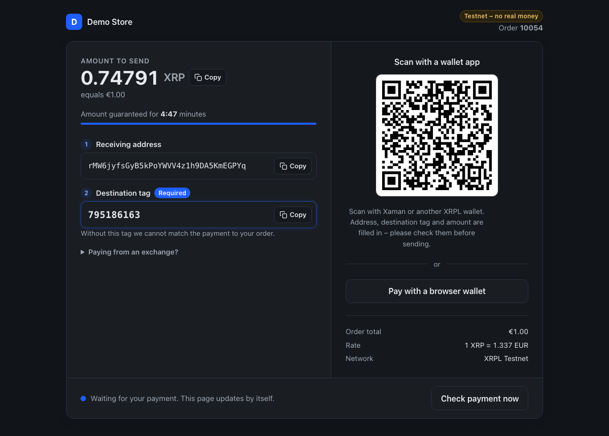

# LedgerDirect for Magento 2

[](https://github.com/ledger-direct/ledger-direct-magento2/actions/workflows/ci.yml)
[](LICENSE)


Accept XRP, RLUSD and USDC directly on the XRP Ledger — no payment processor, no custody, funds
land in the merchant's own wallet.

The module is the Magento 2 adapter over
[`hardcastle/ledger-direct-core`](https://packagist.org/packages/hardcastle/ledger-direct-core), the
shared package that holds the XRPL and pricing logic. Everything platform-specific — the payment
methods, order statuses, invoices and emails, the payment page, the configuration, the cron job —
lives here; price conversion, the oracle set, the stablecoin registry and ledger sync live in the
core and are not reimplemented.

Project website: https://www.ledger-direct.com



## Try it in five minutes

A complete Magento shop with the module, on the XRP Ledger **testnet** — no Magento account, no
access keys, no real money. You need Docker and about 3 GB of disk.

```
git clone https://github.com/ledger-direct/ledger-direct-magento2.git
cd ledger-direct-magento2/dev/try
docker compose up -d --wait        # first start installs the shop: about a minute
```

1. Open http://localhost:8088/: the home page explains the demo and offers the **LedgerDirect demo
   article** (1 EUR). Put it in the cart and check out as a guest with *Pay with XRP*, *RLUSD* or
   *USDC*.
2. The payment page shows the amount, the receiving account and the destination tag. Pay it from a
   testnet wallet — [Xaman](https://xaman.app/) in testnet mode or [Crossmark](https://crossmark.io/)
   — funded from the [XRP Testnet faucet](https://xrpl.org/resources/dev-tools/xrp-faucets); RLUSD
   and USDC come from the [RLUSD faucet](https://tryrlusd.com/) and the
   [Circle faucet](https://faucet.circle.com/). Send the amount exactly as shown, **with the
   destination tag**, or connect the wallet with the buttons on the page.
3. The page notices the payment within seconds and moves on to the order; the order is invoiced and
   *Processing* in the admin at http://localhost:8088/admin (demo login `demo` /
   `demo-ledgerdirect-1` — a local demo login, never reuse it).

On its first start the shop creates its own testnet wallet from the faucet and sets the trust lines
to the RLUSD and USDC issuers on it, so all three assets can be paid right away (`docker compose logs
phpfpm` names the address). The wallet's seed stays in the stack's volume, testnet only. When the
testnet has been reset, the next start notices and creates a new wallet. To receive into an address
of your own instead — it then needs the trust lines itself:

```
LD_TESTNET_ACCOUNT=r... docker compose up -d --wait
```

Setting `LD_TESTNET_ACCOUNT` later works too: the next `up` applies it to the existing shop.
`LD_TRY_PORT` moves the shop off port 8088. `docker compose down` stops the stack and keeps the shop
and its orders; `docker compose down -v` resets everything, and the next `up` installs a fresh shop. `docker compose up --build` builds the image from your checkout instead of
pulling the published one. Magento Open Source comes from
[Mage-OS's public mirror](https://mirror.mage-os.org/); it is not an official Magento image, and
the shop is for trying the module, not for production.

## How it works

A customer picks XRP, RLUSD or USDC at checkout; each is a payment method of its own. The order is
placed straight away as **Pending Payment** and the customer gets a payment page: the exact amount,
the shop's receiving address, and a **destination tag** unique to that order. The tag is what ties an
incoming ledger transaction back to the order, so one wallet address serves every customer. Right
after the order is placed the customer also receives an email with the link to that page (on by
default, see Configuration), so a closed tab is not the end of the payment; the order confirmation
itself is held back until the payment has arrived.

The quote is fixed for a configurable window (five minutes by default). Reloading the page never
changes the amount; once the quote lapses the customer can ask for an updated one, and the
destination tag stays the same so a payment already in flight is not orphaned.

Payments are confirmed three ways, which is deliberate redundancy:

- the payment page polls while the customer is watching,
- a **check now** button for anyone who would rather not wait (and for browsers without JavaScript),
- a cron job that settles orders for customers who closed the page.

An order is credited only from the ledger's `delivered_amount`, only when what arrived covers the
requested amount (XRP within 0.15 %, a stablecoin at least the quoted value), and — for stablecoins —
only when the currency and issuer match: the core's `SettlementPolicy`. Several payments in the
quoted asset add up, so a customer who sent too little can send the rest. Anything else stays open,
and the payment page says why: it shows one of five states — waiting, expired, partial payment (with
the outstanding amount), wrong token (with the full amount still due), or paid — and updates in
place while the customer watches, without reloading.

Once a payment settles the order, the module creates an offline-captured invoice, moves the order
to the method's *settled status* (`processing` by default) and sends the order and invoice emails.
A payment that arrives but does not pay the order moves it to its own status, **XRPL payment
incomplete** (state `pending_payment`), with the amounts and the transaction hash in the status
history; the order keeps being matched, and a top-up of the shortfall settles it. Magento's own job
that cancels orders left in `pending_payment` after *Pending Payment Order Lifetime* (480 minutes
by default) does not touch an order with that status, because there is real money on the ledger
for it. The order's *Payment Information* — on the admin order view, in the customer's order view
and in the order emails — lists what was quoted (asset, amount, rate, receiving account,
destination tag, issuer for a stablecoin), the payment status, what arrived and what is still due,
and the transaction hash as a link to the XRPL explorer.

The page asks the server every 8 seconds. That endpoint syncs with the XRPL node at most once every
5 seconds per receiving account, whatever the number of customers waiting; in between it answers
from what is already stored. A guest order can poll too — the link carries the order's key
(Magento's own `protect_code`, the secret behind the guest order view), and no login is required.

## Requirements

- Magento Open Source or Adobe Commerce 2.4.7 or 2.4.8
- PHP 8.2, 8.3 or 8.4
- A running Magento cron, for the settlement job
- An XRP Ledger account. Accepting RLUSD or USDC additionally requires a **trustline** to the
  respective issuer on that account, or payments will fail on the ledger.

## Installation

The module is installed with Composer from
[Packagist](https://packagist.org/packages/hardcastle/ledger-direct-magento2); the git tags are
the versions. Run the commands in the root directory of the Magento installation, the one with
Magento's own `composer.json`:

```
composer require hardcastle/ledger-direct-magento2
bin/magento setup:upgrade
bin/magento setup:di:compile
bin/magento setup:static-content:deploy -f
```

The module depends on `magento/framework`, which Composer only finds through `repo.magento.com`
as configured in that project. Run in an empty directory, `composer require` therefore reports
that `magento/framework` "could not be found in any version"; that is expected for any Magento
extension and not a problem with the package. Composer 2.9 and later also refuses to resolve
dependencies that have known security advisories, and older Magento patch releases lock several
of them — if `composer require` fails with "affected by security advisories", update Magento to
its current patch release first.

This also installs `hardcastle/ledger-direct-core` from Packagist. If you place the module under
`app/code/Hardcastle/LedgerDirect` instead, Composer does not read the module's own `composer.json`;
require its two dependencies at project level yourself
(`composer require hardcastle/ledger-direct-core:^0.9 "bacon/bacon-qr-code:^2.0 || ^3.0"`, the
QR-code library renders the payment page's code for browsers without JavaScript) and run the same
three `bin/magento` commands.

Installing creates two tables for ledger data (synced transactions and the destination-tag counter)
and the order status *XRPL payment incomplete*. Updates run through `setup:upgrade` as usual.

`bin/magento module:uninstall Hardcastle_LedgerDirect` keeps the module's tables. Adding
`--remove-data` drops them, including the destination-tag counter — the only record of which tags
were already issued. A reinstall then starts a fresh counter, and payments for orders that are still
waiting can no longer be matched. Only remove the data once no LedgerDirect order is open.

## Configuration

Stores → Configuration → Sales → Payment Methods → Ledger Direct / XRPL:

| Setting | |
|---|---|
| Enabled | Switches the XRP payment method on. |
| Use testnet | The receiving account must belong to the selected network. |
| Account, testnet and mainnet | The shop's receiving account on each network; the one for the selected network is used. |
| Quote validity (seconds) | How long a quoted amount stays fixed. Default 300. |
| Send payment instructions email, sender, template | The email with the link to the payment page, sent right after the order is placed. On by default. |
| Payment page: logo | What the payment page shows in its header: the store logo, an uploaded picture (PNG, JPG, SVG or WebP, at most 160 by 32 pixels), or the first letter of the store name. |
| Payment page: accent colour | The one colour of the payment page — buttons, countdown bar, destination tag — with white text on it, so it must be dark enough (contrast 4.5:1). Default `#1f5eff`; a lighter colour is refused on save. |
| Payment page: Xaman API key, WalletConnect project id | Public identifiers, optional. With one of them, customers on a phone get an "Open in wallet app" button. Never the API secret. |

The stablecoins are payment methods of their own, each with its *Enabled* switch and title, in the
groups *Ledger Direct – RLUSD (XRPL)* and *Ledger Direct – USDC (XRPL)* next to it. They are off by
default and need the trustline on the receiving account first.

Issuer addresses are not configurable. They are fixed in the core: a wrong issuer would send
customer funds to a dead trustline.

The cron job `ledger_direct_settle_pending_orders` runs every five minutes with Magento's cron and
makes one node request per receiving account and network, then matches every open order against
the stored transactions. Without it, a customer who closes the payment page before their
transaction confirms is only settled the next time someone visits their payment page.

## Test payments

Switch *Use testnet* on and enter a testnet account. Test accounts come from the
[XRP Testnet faucet](https://xrpl.org/xrp-testnet-faucet.html) for XRP, the
[RLUSD faucet](https://tryrlusd.com/) for RLUSD and the [Circle faucet](https://faucet.circle.com/)
for USDC; the receiving account needs the trustlines, the paying wallet needs the tokens.

## The payment page

After checkout the customer lands on `/ledger-direct/payment/index?id=<order entity id>&key=<protect_code>`,
a page on an empty layout — no header, footer or navigation — with the store's logo or monogram in its
header. A wrong key or id is refused with 403 without saying whether the order exists. The page polls
`/ledger-direct/payment/status` with the same parameters, which returns the same payload as every
other LedgerDirect plugin (`INVARIANTS.md` in the core, "Payment status"), plus a `redirect` URL once
the order no longer waits for payment — whether it was paid on the ledger or canceled by the
merchant.

Behaviour and design come from [`@ledger-direct/payment-ui`](https://github.com/ledger-direct/ledger-direct-payment-ui),
the package every LedgerDirect plugin shares: the five payment states, the countdown, polling,
copy buttons, the QR code with address, destination tag and amount, and browser wallets over
XRPL Connect (Crossmark, GemWallet, MetaMask Snap, Ledger, Otsu, Xyra; Xaman and WalletConnect
with the identifiers above). The module has no build step: it ships the package's built files
under `view/frontend/web/`.

| File | From the package | Loaded |
|---|---|---|
| `view/frontend/web/css/payment-page.min.css` | `dist/payment-page.css` | with the page |
| `view/frontend/web/js/ledger-direct-payment-ui/payment-page.min.js` | `dist/payment-page.js` | with the page |
| `view/frontend/web/js/ledger-direct-payment-ui/wallets.min.js` | `dist/wallets.js` | only when the customer opens the wallet list, by a native `import()` |

The files carry `.min.` in their name so Magento's own minifier leaves them alone.
`view/frontend/web/js/ledger-direct-payment-ui/VERSION` names the package tag the files were copied
from. To update: copy the three files from the package's `dist/` at the new tag to those names and
write the tag into `VERSION`. The template renders the package's markup contract (`src/README.md`
there) from a view model; every sentence a customer reads is in
`view/frontend/templates/payment/index.phtml` and `i18n/*.csv`, nothing is rounded or reformatted in
the browser.

Without JavaScript the page still works: the amount, address and tag are server-rendered, the QR
code is drawn on the server from the same payment request, and the "Check payment now" button is a
plain form that reloads the page, which syncs and settles.

## External services

Exchange rates come from the public APIs of Coingecko, Binance and Kraken, through the core. No
personal or payment data is sent to them; only the current rate is requested when a payment is
quoted or displayed, and rates are cached briefly in Magento's cache so a short outage of one source
does not interrupt checkout.

- Coingecko API: [Terms of Service](https://www.coingecko.com/en/terms), [Privacy Policy](https://www.coingecko.com/en/privacy)
- Binance API: [Terms of Use](https://www.binance.com/en/terms), [Privacy Policy](https://www.binance.com/en/privacy)
- Kraken API: [Terms of Service](https://www.kraken.com/legal), [Privacy Policy](https://www.kraken.com/privacy)

## Development

How the whole of LedgerDirect is tested across the core, the shared page package and the four
plugins — the layers, what each catches, the nightly end-to-end runs and the manual cases — is in
[`docs/testing.md` of the core](https://github.com/ledger-direct/ledger-direct-core-php/blob/master/docs/testing.md).
The manual cases for this module, by the core's case IDs, are in `docs/manual-tests/payment-status.md`.

The module is developed inside a Magento project, under `app/code/Hardcastle/LedgerDirect`, whose
Composer autoloader the tests use. From the Magento root:

```
vendor/bin/phpunit -c app/code/Hardcastle/LedgerDirect/tests/phpunit.xml.dist
```

The unit suite runs the real core services and stubs only the edges this module owns: the HTTP
client, the transaction repository port and Magento's repositories. It is offline by design and
needs no database. `tests/README.md` has the details, including the Magento Marketplace keys CI
needs to build a Magento project.

To work against a local core checkout instead of the released version, add a path repository to
the *Magento project's* `composer.json` and require the branch; keep the module's own constraint on
the released version:

```
composer config repositories.ledger-direct-core path ../LedgerDirectCorePHP/ledger-direct-core-php
composer require hardcastle/ledger-direct-core:dev-master
```

### Continuous integration and release

Every push and pull request runs `.github/workflows/ci.yml`: PHP syntax, the Magento 2 coding
standard (`magento/magento-coding-standard`), and the PHPUnit suite inside a real Magento 2.4.7 and
2.4.8 project, which needs the `MAGENTO_COMPOSER_AUTH` secret with Marketplace access keys; without
it that job logs a warning and skips. There is no nightly end-to-end run for Magento yet.

A release is a git tag, which Packagist picks up and Composer resolves as the module's version;
`composer.json` carries no version field of its own. `CHANGELOG.md` lists the versions.

The Adobe Commerce Marketplace wants the same code as a zip with `version` in its `composer.json`:
`bin/marketplace-zip.sh <tag>` builds `build/Hardcastle_LedgerDirect-<tag>.zip` from the tag, writes
the version into the copy, checks the fields the technical review requires and leaves tests and
tooling out (`.gitattributes` export-ignore, the same rules Packagist applies). The listing's assets
live in `docs/marketplace/`: the icon, the user guide (`bin/docs-pdf.sh` renders it from this README)
and the release notes per version.

## Translations

English and German, as `i18n/en_US.csv` and `i18n/de_DE.csv`.

## License

MIT — see [LICENSE](LICENSE).
